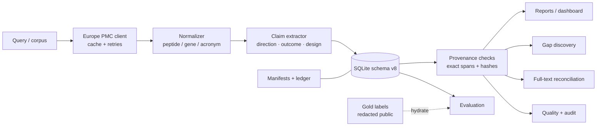

# ntx

**Provenance-first evidence surveillance for neuropeptides, neurotrophins and
neurotropic claims.**

[](https://github.com/toniIepure25/neuropeptides/actions/workflows/ci.yml)
[](https://github.com/toniIepure25/neuropeptides/releases)
[](pyproject.toml)
[](LICENSE)
[](LICENSE-DOCS)

> **Research software, not a clinical decision tool.** `ntx` retrieves and
> structures published evidence. It does not establish efficacy, safety or a
> therapeutic recommendation. Verify every claim against the source paper.

`ntx` turns a literature query into an auditable evidence database: normalized
peptide/neurotrophic entities, directional claims with exact character spans,
study-design appraisals, effect extraction, testable evidence gaps, and
self-contained reports. The runtime is Python standard library only and the
default workflow runs fully offline.

## Why this exists

Neuropeptide and neurotrophic evidence is fragmented across thousands of papers,
mixes human trials with animal and in-vitro work, and frequently reports
direction without a comparable effect size. A useful surveillance system must be
able to answer four questions at once:

1. **What was said?** — a claim linked to the exact source sentence.
2. **How strong is it?** — design, species, sample size and effect context.
3. **What is missing?** — untested peptide × outcome × model combinations.
4. **Can I reproduce it?** — deterministic IDs, hashes, manifests and byte-stable
   reports.

`ntx` is built around those four questions rather than around a single extraction
score.

## Quick start

```powershell
git clone https://github.com/toniIepure25/neuropeptides.git
cd neuropeptides
python -m venv .venv
.\.venv\Scripts\Activate.ps1
python -m pip install -e ".[dev]"

python -m ntx --frozen-time demo --db build\ntx.db --out reports
python -m ntx check --db build\ntx.db
python -m ntx quality --db build\ntx.db
python -m ntx discover --db build\ntx.db --top 10
```

The bundled demo is an 18-record, CC BY subset of Europe PMC metadata. A frozen
run currently produces **18 documents → 61 mentions → 14 claims → 36 entities**,
with zero provenance errors and self-contained HTML briefs for OXT, NPY, BDNF and
Semax.

### Common commands

```text
ntx demo                 offline demo database + reports
ntx ingest               fetch Europe PMC records and process them
ntx report               render entity briefs from an existing database
ntx check                verify every exact-span and full-text invariant
ntx quality              machine-readable quality gates
ntx dashboard            self-contained HTML quality dashboard
ntx discover             rank testable evidence gaps
ntx synthesize           design-weighted summary per entity and outcome
ntx mechanism            inspect/simulate the signed mechanism graph
ntx fulltext             fetch, extract and compare open-access full text
ntx eval                 score against a hydrated gold file
ntx gold                 validate, merge, redact, hydrate annotations
ntx audit                draw and score a manual audit sample
ntx serve                read-only local JSON API
ntx doctor               database, schema and provenance diagnostics
```

Run `python -m ntx <command> --help` for options.

## Architecture



### Design principles

- **Local-first.** Abstracts, full text and databases stay on your machine.
- **No LLM in the core.** Extraction is deterministic, inspectable and testable.
- **Fail closed.** A report refuses to render when an exact-span check fails.
- **Hash-addressed provenance.** Content hashes, run manifests and a local ledger
  chain make silent edits visible.
- **Honest evaluation.** Draft/model labels are never presented as human gold.

## Evidence guarantees

Every abstract claim stores `doc_id`, `entity_id`, `start`, `end`, `sentence`,
`direction`, `outcome`, `role` and `design`. The core invariant is:

```python
text[claim.start : claim.end] == claim.sentence
```

`ntx check` also verifies full-text claims against their immutable snapshot and
`text_hash`. Reports and the API refuse to serve inconsistent state rather than
silently repairing it. Run manifests record the code version, git SHA, dirty
state, Python/platform, ontology and corpus hashes, schema version and a
content-addressed `run_id`.

## Evaluation status

This repository does **not** yet contain a human-validated gold set.
`gold/pilot.jsonl` and `gold/v2/draft.jsonl` are label/span artefacts; the latter
is model-assisted. They can measure agreement and pipeline stability, but they
must not be reported as human accuracy.

Public gold files are **text-free**: sentences and surfaces are replaced by
SHA-256 hashes. Restore them locally against a corpus you are entitled to use:

```powershell
python -m ntx gold hydrate `
  --in gold/v2/draft.jsonl `
  --corpus data/gold/corpus_v2.json `
  --out build/gold.full.jsonl

python -m ntx gold validate --file build/gold.full.jsonl --corpus data/gold/corpus_v2.json
python -m ntx eval --db build/ntx.db --gold build/gold.full.jsonl
```

`ntx eval` refuses redacted input. Hydration verifies every span and hash and
fails if the corpus has changed. See [`gold/README.md`](gold/README.md).

### Current engineering metrics

Measured on the public tree with Python 3.13:

| Metric | Current |
| --- | ---: |
| Tests | 293 |
| Line coverage | 93.31% |
| Branch coverage | 85.00% |
| Combined coverage | 91.11% |
| Demo records | 18 |
| Provenance errors | 0 |

These numbers describe software quality, not scientific validity. No
human-gold precision, recall or F1 is claimed.

## Repository layout

```text
src/ntx/                  runtime package (stdlib only)
  extract.py              deterministic entity/claim extraction
  store.py                SQLite schema v8 and queries
  annotation.py           gold schema, redaction and hydration
  eval.py                 mention/claim/effect evaluation
  report.py               self-contained HTML briefs
  discover.py             evidence-gap ranking
  fulltext.py             open-access JATS reconciliation
  quality.py              quality payload and gates
  serve.py                read-only JSON API
gold/                     redacted labels, protocol, sampling frame
docs/                     architecture, method, governance, release notes
scripts/                  CI, release and reproducibility helpers
tests/                    unittest/pytest suite
```

## Reproducibility

```powershell
$env:SOURCE_DATE_EPOCH = "1794680589"
python -m build --sdist --wheel --outdir dist
python scripts/normalize_sdist.py dist\*.tar.gz --epoch 1794680589
```

CI builds twice with the same epoch and compares hashes, installs the wheel in a
clean environment, runs the demo outside the repository, and checks that two
frozen-time report directories are byte-identical. Release assets include a
`SHA256SUMS` file.

## Data and licensing

| Component | Licence / policy |
| --- | --- |
| ntx code | [MIT](LICENSE) |
| Documentation | [CC BY 4.0](LICENSE-DOCS) |
| Bundled demo corpus | Only explicit **CC BY** records, attributed in [`src/ntx/data/ATTRIBUTION.md`](src/ntx/data/ATTRIBUTION.md) |
| Other abstracts/full text | Local-only; not committed or packaged |
| Public gold labels | Text-free labels, spans and SHA-256 hashes |

The demo corpus is a filtered snapshot, not a systematic review. Users are
responsible for the upstream licence of every record they retrieve. See
[`docs/DATA_GOVERNANCE.md`](docs/DATA_GOVERNANCE.md).

## Development

```powershell
python -m ruff check .
python -m ruff format --check .
python -m mypy src/ntx
python -m pytest --cov=ntx --cov-branch --cov-report=term-missing --cov-report=json:coverage.json
python scripts/coverage_gate.py coverage.json --line 93 --branch 85 --combined 90
python scripts/check_release.py
```

The full local gate, including a clean-wheel install and demo, is
`python scripts/ci.ps1`. Contributions must preserve exact provenance, avoid
third-party text in public artefacts, and keep default reports deterministic.
See [`CONTRIBUTING.md`](CONTRIBUTING.md).

## Citation

If you use this software, cite the repository and the specific release:

```bibtex
@software{iepure_ntx_2026,
  author  = {Iepure, Antoniu},
  title   = {ntx: provenance-first surveillance and hypothesis triage for
             neuropeptide and neurotrophic claims},
  year    = {2026},
  version = {0.17.0},
  url     = {https://github.com/toniIepure25/neuropeptides},
  license = {MIT}
}
```

Machine-readable metadata is in [`CITATION.cff`](CITATION.cff). A DOI will be
added when an archive is minted; none is claimed here.

## Security

Report vulnerabilities through GitHub's private vulnerability reporting, not a
public issue. The optional API binds to loopback by default; non-loopback binds
require a token of at least 16 characters and an explicit Host allowlist. See
[`SECURITY.md`](SECURITY.md).

## Limitations and non-goals

- No PDF layout analysis or OCR; full text is JATS XML from PMC.
- No LLM-based extraction and no learned ranking in the core.
- No multi-user service, tenant isolation, TLS termination or SaaS deployment.
- Effect sizes are heuristic extractions and are not pooled meta-analytically.
- The demo is small and filtered; absence of a claim is not evidence of absence.
- Human gold, a DOI and clinical validation remain future work.

## Documentation

- [Architecture](docs/ARCHITECTURE.md)
- [Method and version history](docs/METHOD.md)
- [Full-text reconciliation](docs/FULLTEXT.md)
- [Data governance](docs/DATA_GOVERNANCE.md)
- [Gold protocol](gold/PROTOCOL_V2.md) and [codebook](gold/GUIDELINES.md)
- [Release checklist](docs/RELEASE_CHECKLIST.md)
- [Changelog](CHANGELOG.md)

## Version history

`0.17.0` is the first sanitized public release: text-free gold, a CC BY demo
subset, PEP 561 typing and a tag-driven release workflow. Earlier versions added
full-text reconciliation, quantitative effects, quality gates, backups, the API
and the discovery/synthesis layers. See [`CHANGELOG.md`](CHANGELOG.md).
